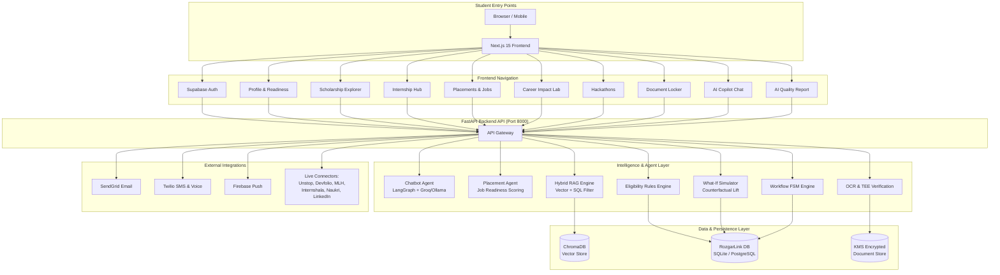
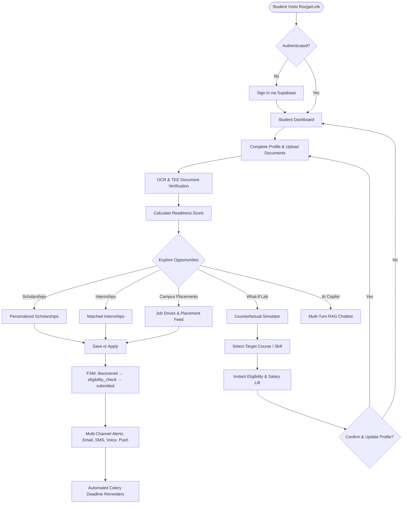

# RozgarLink 3.0 - AI Career & Student Success Copilot

**Comprehensive Technical Documentation**

> A production-grade multi-agent AI platform designed specifically for Indian students and graduates, unifying scholarship discovery, campus & lateral placement matching, internship tracking, hackathon aggregation, document verification with OCR & TEE simulation, counterfactual what-if career impact simulation, and continuous Ragas AI evaluation through conversational AI.

---

## Table of Contents

1. [Project Overview](#project-overview)
2. [Tech Stack](#tech-stack)
3. [Architecture](#architecture)
4. [Project Structure](#project-structure)
5. [Complete Workflow Diagram](#complete-workflow-diagram)
6. [Complete End-to-End Feature Integration Workflow](#complete-end-to-end-feature-integration-workflow)
7. [Feature-by-Feature Documentation](#feature-by-feature-documentation)
   - [Feature 1: Conversational AI Copilot (Groq + LangGraph)](#feature-1-conversational-ai-copilot-groq--langgraph)
   - [Feature 2: Two-Stage Hybrid RAG Engine](#feature-2-two-stage-hybrid-rag-engine)
   - [Feature 3: Scholarship Discovery & Eligibility Rule Engine](#feature-3-scholarship-discovery--eligibility-rule-engine)
   - [Feature 4: Live Hackathon Aggregator](#feature-4-live-hackathon-aggregator)
   - [Feature 5: Internship Finder & Readiness Scoring](#feature-5-internship-finder--readiness-scoring)
   - [Feature 6: Campus Placements & Job Drives Tracker](#feature-6-campus-placements--job-drives-tracker)
   - [Feature 7: Career Impact Lab: Counterfactual What-If Simulator & Skill Gaps](#feature-7-career-impact-lab-counterfactual-what-if-simulator--skill-gaps)
   - [Feature 8: TEE-Protected Document Verification (OCR + KMS)](#feature-8-tee-protected-document-verification-ocr--kms)
   - [Feature 9: Multi-Channel Notification Orchestrator (Email, SMS, Push, Voice)](#feature-9-multi-channel-notification-orchestrator-email-sms-push-voice)
   - [Feature 10: Live Data Ingestion Pipeline & Connector Registry](#feature-10-live-data-ingestion-pipeline--connector-registry)
   - [Feature 11: A/B Testing & Recommendation Experimentation Framework](#feature-11-ab-testing--recommendation-experimentation-framework)
   - [Feature 12: Application Workflow State Machine (FSM)](#feature-12-application-workflow-state-machine-fsm)
   - [Feature 13: DPDP Act 2023 Consent & Tamper-Evident Audit Logging](#feature-13-dpdp-act-2023-consent--tamper-evident-audit-logging)
   - [Feature 14: Continuous AI Quality & Ragas Evaluation Framework](#feature-14-continuous-ai-quality--ragas-evaluation-framework)
8. [Installation & Setup](#installation--setup)
9. [Testing](#testing)
10. [AI Quality Metrics & Evaluation (Ragas Benchmark)](#ai-quality-metrics--evaluation-ragas-benchmark)
11. [API Endpoints Reference](#api-endpoints-reference)
12. [Database Schema Reference](#database-schema-reference)
13. [Environment Variables Reference](#environment-variables-reference)
14. [Troubleshooting Guide](#troubleshooting-guide)
15. [Contributing](#contributing)
16. [License & Acknowledgments](#license--acknowledgments)

---

## Project Overview

**RozgarLink** is an agentic AI platform designed specifically for Indian students to bridge the gap between education, government welfare, and career employment:

- **Discover** scholarships, internships, hackathons, and job drives from 850+ sources (AICTE, NSP, Unstop, Devfolio, MLH, Internshala, Naukri, LinkedIn, Wellfound).
- **Match Placements & Jobs** tailored to academic stream, CGPA, backlogs, technical skills, and preferred locations with placement readiness scoring.
- **Simulate Counterfactual Career Scenarios** in the Career Impact Lab ("What-If Simulator") to quantify how acquiring new skills, certifications, or CGPA uplifts eligibility for high-paying roles before altering profiles.
- **Verify Eligibility** automatically using an AI-powered rule engine with state domicile, gender, caste category, annual income, and academic thresholds.
- **Process Documents** (Aadhaar, income certificates, marksheets) securely using OCR with TEE simulation, KMS envelope encryption, and field confidence scoring.
- **Recommend Opportunities** personalized with two-stage hybrid RAG (brief scannable lists followed by deep criteria disclosures).
- **Notify Proactively** across Email, SMS, Firebase Push, and automated Twilio Voice reminders for critical application deadlines.
- **Chat Naturally** with a LangGraph multi-agent chatbot powered by high-speed Groq Cloud LLMs and local Ollama inference.
- **Track Workflows** through a deterministic 8-stage Finite State Machine (FSM).
- **Comply with DPDP Act 2023** via explicit consent records and immutable audit logs.
- **Evaluate AI Quality** continuously using Ragas metrics (Faithfulness, Relevancy, Precision, Recall).

---

## Tech Stack

### Frontend (Next.js 15)
- **Framework**: Next.js 15.3.3 (App Router, Server & Client Components)
- **Language**: TypeScript 5
- **UI Library**: React 19.2.4
- **Styling**: TailwindCSS 4 + PostCSS
- **Authentication**: Supabase Auth (`@supabase/ssr`, `@supabase/supabase-js`)
- **Icons**: Lucide React
- **Theme**: next-themes (dark and light mode)
- **Client Routing**: Next.js App Router (`app/app/dashboard/*`)

### Backend (Python FastAPI)
- **Framework**: FastAPI 0.115+
- **Server**: Uvicorn (ASGI)
- **ORM**: SQLAlchemy 2.0 (Modern Mapped Columns)
- **Database**: SQLite 3 (default `rozgarlink.db`) + PostgreSQL 16 (pgvector for production)
- **Vector DB**: ChromaDB 0.5+ (persistent on-disk vector store)
- **Task Queue**: Celery 5.4 + Redis 7 (caching, celery broker, result backend)
- **Validation**: Pydantic 2.8+ / Pydantic Settings

### AI & Agentic Stack
- **Primary LLM**: Groq Cloud API (`openai/gpt-oss-120b`, `llama-3.3-70b-versatile`)
- **Local/Sidecar LLM**: Ollama (`llama3:8b`, `llama3.2:3b`)
- **Agent Orchestration**: LangGraph 0.2+ (State Graphs, Cycles, Short-term Checkpointing)
- **Prompt & Tooling**: LangChain Core 0.3+
- **Embeddings**: sentence-transformers 2.2+ (`all-MiniLM-L6-v2`)
- **Evaluation**: Ragas Framework + DeepEval with judge models (`gemma4:31b-cloud`)
- **OCR Engine**: Tesseract OCR (`pytesseract 0.3+`)

### External Services & Connectors
- **Email**: SendGrid API v3
- **SMS & Voice Calls**: Twilio REST API
- **Push Notifications**: Firebase Cloud Messaging (FCM Admin SDK)
- **Live Ingestion**: Playwright + httpx + BeautifulSoup4
- **Security & KMS**: Cryptography (AES-256-GCM, PBKDF2-HMAC-SHA256, Fernet)

---

## Architecture

**RozgarLink** follows a modular **microservices-inspired monolith** architecture:

```
┌─────────────────────────────────────────────────────────────────┐
│                    NEXT.JS 15 FRONTEND (PORT 3000)             │
│  ┌──────────┐  ┌──────────┐  ┌──────────┐  ┌──────────────────┐ │
│  │Dashboard │  │ Placements│ │ What-If  │  │ AI Chat & RAG    │ │
│  └────┬─────┘  └────┬─────┘  └────┬─────┘  └────────┬─────────┘ │
└───────┼─────────────┼─────────────┼─────────────────┼───────────┘
        │             │             │                 │
        ▼             ▼             ▼                 ▼
┌─────────────────────────────────────────────────────────────────┐
│                 FASTAPI REST API GATEWAY (PORT 8000)            │
│  - Supabase JWT Verification   - Experiment Context Middleware  │
│  - CORS Middleware             - Global Error Handlers          │
└───────────────────────────────┬─────────────────────────────────┘
                                │
        ┌───────────────────────┼────────────────────────┐
        ▼                       ▼                        ▼
┌───────────────┐       ┌───────────────┐        ┌───────────────┐
│ AGENT LAYER   │       │ INTELLIGENCE  │        │ SECURITY & TEE│
│ - Chatbot     │       │ - Hybrid RAG  │        │ - AES-256 KMS │
│ - Placement   │       │ - Eligibility │        │ - OCR Pipeline│
│ - Internship  │       │ - Simulator   │        │ - DPDP Consent│
│ - Hackathon   │       │ - Vector Svc  │        │ - Audit Logs  │
└───────┬───────┘       └───────┬───────┘        └───────┬───────┘
        │                       │                        │
        └───────────────────────┼────────────────────────┘
                                │
        ┌───────────────────────┼────────────────────────┐
        ▼                       ▼                        ▼
┌───────────────┐       ┌───────────────┐        ┌───────────────┐
│ NOTIFICATIONS │       │ INGESTION     │        │ WORKFLOW FSM  │
│ - SendGrid    │       │ - Connectors  │        │ - 8 States    │
│ - Twilio SMS  │       │ - Normalizer  │        │ - Reviewer Q  │
│ - Twilio Voice│       │ - Dedup       │        │ - Event Logs  │
│ - Firebase FCM│       │ - Scheduler   │        │               │
└───────┬───────┘       └───────┬───────┘        └───────┬───────┘
        │                       │                        │
        └───────────────────────┼────────────────────────┘
                                │
        ┌───────────────────────┴────────────────────────┐
        ▼                                                ▼
┌───────────────────────────────┐        ┌───────────────────────────────┐
│      RELATIONAL STORAGE       │        │      VECTOR EMBEDDINGS        │
│ SQLite (`rozgarlink.db`)      │        │ ChromaDB (`chroma_data/`)     │
│ or PostgreSQL 16 (pgvector)   │        │ 384-dim semantic embeddings   │
└───────────────────────────────┘        └───────────────────────────────┘
```

---

## Project Structure

```
votexa3.0-rozgarlink/
├── app/                                 # Next.js 15 Frontend
│   ├── app/                             # Next.js App Router
│   │   ├── auth/                        # Supabase Auth (login, signup, callback)
│   │   ├── dashboard/                   # Student & Admin Dashboard Views
│   │   │   ├── _components/             # UI Components (Placements, WhatIf, Eval, etc.)
│   │   │   ├── admin/                   # System admin monitoring
│   │   │   ├── applications/            # Saved & applied workflow tracker
│   │   │   ├── chat/                    # AI Copilot Chat Interface
│   │   │   ├── documents/               # Document Locker & OCR Status
│   │   │   ├── eval/                    # AI Quality & Ragas Evaluation Report
│   │   │   ├── hackathons/              # Live Hackathon Directory
│   │   │   ├── internships/             # Internship Listings & Scoring
│   │   │   ├── notifications/           # Channel Preferences & Delivery Log
│   │   │   ├── placements/              # Campus & Lateral Placement Drives
│   │   │   ├── profile/                 # Academic & Demographic Profile Editor
│   │   │   ├── scholarships/            # Scholarship Explorer
│   │   │   ├── search/                  # Universal Semantic Search
│   │   │   ├── skill-gaps/              # Skill Gap Analysis & High-Impact Pathways
│   │   │   └── what-if/                 # Counterfactual Eligibility Simulator
│   │   ├── globals.css                  # Design system tokens and styles
│   │   ├── layout.tsx                   # Root HTML & Metadata layout
│   │   ├── loading.tsx                  # Animated terminal loader
│   │   └── page.tsx                     # Landing page with hero, stats, feature grid
│   ├── components/                      # Global Navbar, Footer, Session Guard
│   ├── lib/                             # Supabase clients & shared frontend utilities
│   ├── public/                          # Static assets, branding logos, icons
│   └── package.json                     # Frontend dependencies
│
├── services/                            # FastAPI Backend Service
│   ├── app/
│   │   ├── agents/                      # Specialized Agent Implementations
│   │   │   ├── chatbot.py               # LangGraph Chatbot Agent (Ollama + Groq)
│   │   │   ├── document_identifier.py   # Document classification & OCR validation
│   │   │   ├── hackathon.py             # Hackathon matching agent
│   │   │   ├── internship.py            # Internship eligibility agent
│   │   │   ├── placement.py             # Placement matching & readiness agent
│   │   │   └── scholarship.py           # Scholarship rules & recommendation agent
│   │   ├── analytics/                   # A/B Testing, User Events, Metrics Calculator
│   │   ├── api/
│   │   │   ├── middleware/              # Experiment context & session tracking
│   │   │   └── routes/                  # 18 RESTful Route Modules
│   │   │       ├── admin.py             # Admin ops & pipeline triggers
│   │   │       ├── chat.py              # Chat threads, messages, streaming
│   │   │       ├── connectors.py        # Connector manual runs & health
│   │   │       ├── consent.py           # DPDP consent grant/revoke
│   │   │       ├── documents_api.py     # Document upload, OCR, verification
│   │   │       ├── eval.py              # Ragas benchmark execution & metrics
│   │   │       ├── experiments.py       # A/B variant testing & CTR analytics
│   │   │       ├── feedback.py          # Opportunity relevance feedback
│   │   │       ├── hackathons.py        # Hackathon catalog & subscriptions
│   │   │       ├── internships.py       # Internship catalog & scoring
│   │   │       ├── notification_prefs.py# Channel preference management
│   │   │       ├── notifications.py     # In-app notifications & history
│   │   │       ├── placements.py        # Placement recommendations & search
│   │   │       ├── profile.py           # Profile CRUD & readiness scoring
│   │   │       ├── scholarships.py      # Scholarship catalog & eligibility
│   │   │       ├── search_api.py        # Hybrid semantic & structured search
│   │   │       ├── simulation.py        # Counterfactual What-If simulation
│   │   │       └── workflow.py          # Application state machine transitions
│   │   ├── config.py                    # Pydantic Settings & environment config
│   │   ├── db/
│   │   │   ├── models.py                # 24 SQLAlchemy models
│   │   │   └── session.py               # Engine, SessionLocal, table initialization
│   │   ├── ingestion/                   # Live Connectors & Data Orchestrator
│   │   │   ├── base.py                  # BaseConnector abstract class
│   │   │   ├── connector_registry.py    # Dynamic connector discovery & registry
│   │   │   ├── connectors.py            # Unstop, Devfolio, MLH, Internshala, AICTE
│   │   │   ├── normalizer.py            # Deduplication & schema normalization
│   │   │   ├── pipeline.py              # Pipeline execution orchestrator
│   │   │   └── placement_connectors.py  # Naukri, LinkedIn, Wellfound connectors
│   │   ├── intelligence/                # AI Intelligence Engines
│   │   │   ├── eligibility.py           # Rule-based eligibility validator
│   │   │   ├── embeddings.py            # Sentence-transformer embeddings
│   │   │   ├── recommendation.py        # Hybrid ranking & scoring algorithm
│   │   │   ├── vector_search.py         # ChromaDB query utilities
│   │   │   └── what_if_simulator.py     # Counterfactual simulation engine
│   │   ├── knowledge/                   # Hybrid RAG & Knowledge Base
│   │   ├── notifications/               # SendGrid, Twilio SMS/Voice, Firebase FCM
│   │   ├── schemas/                     # Pydantic request/response schemas
│   │   ├── security/                    # KMS envelope encryption, TEE, DPDP consent
│   │   ├── verification/                # OCR pipeline & government verification
│   │   └── workflow/                    # Finite State Machine implementation
│   ├── eval/                            # Ragas & DeepEval Golden test benches
│   ├── tests/                           # Pytest test suite
│   ├── rozgarlink.db                    # Active SQLite development database
│   ├── requirements.txt                 # Backend Python dependencies
│   └── .env                             # Backend environment secrets
│
├── chroma_data/                         # Persistent ChromaDB vector collections
├── docker-compose.yml                   # Production container orchestration
├── check_db.py                          # Database inspection & verification script
├── ARCHITECTURE.md                      # Detailed technical architecture guide
├── STARTUP.md                           # Quick start developer walkthrough
└── README.md                            # Main project technical documentation
```

---

## Complete Workflow Diagram



---

## Complete End-to-End Feature Integration Workflow



---

## Feature-by-Feature Documentation

### Feature 1: Conversational AI Copilot (Groq + LangGraph)

#### What It Does
An intelligent, multi-turn AI copilot that assists students with personalized scholarship recommendations, eligibility criteria clarifications, application deadlines, and career roadmap guidance.

#### How It Works Internally
1. **User Query**: Incoming message via `POST /api/v1/chat` or `POST /api/v1/chat/stream`.
2. **Conversation Checkpointing**: Loads session state and durable history from `chat_threads` and `chat_messages`.
3. **Context Retrieval**: Queries ChromaDB for semantic candidates and cross-validates with the active student profile.
4. **Agent Graph Execution**: LangGraph state graph determines whether to execute a brief summary response or an in-depth breakdown.
5. **Streaming Synthesis**: Streams tokens back from Groq API (`openai/gpt-oss-120b`) or local Ollama fallback.
6. **Memory Consolidation**: Extracts and persists long-term user preferences in `user_memories`.

#### Key Files
- `services/app/agents/chatbot.py`: Core LangGraph agent and system prompt.
- `services/app/api/routes/chat.py`: Streaming and thread management endpoints.
- `services/app/knowledge/hybrid_rag.py`: Knowledge retrieval orchestrator.

---

### Feature 2: Two-Stage Hybrid RAG Engine

#### What It Does
Combines dense vector semantic similarity with deterministic SQL rule filtering to ensure 0% hallucinated criteria and 100% relevant opportunities.

#### How It Works Internally
1. **Vector Candidate Generation**: Performs cosine similarity search in ChromaDB (top 25 candidates).
2. **Metadata Filtering**: Extracts criteria constraints (maximum family income, minimum CGPA, gender, domicile state).
3. **Scoring & Ranking**: Computes combined score:
   $$\text{Final Score} = 0.6 \times \text{Semantic Score} + 0.4 \times \text{Eligibility Score}$$
4. **Two-Stage Presentation**: Returns scannable summary cards initially; delivers deep breakdown when expanded or queried in chat.

#### Key Files
- `services/app/intelligence/vector_search.py`
- `services/app/intelligence/eligibility.py`
- `services/app/intelligence/recommendation.py`

---

### Feature 3: Scholarship Discovery & Eligibility Rule Engine

#### What It Does
Evaluates complex Indian scholarship requirements (NSP, AICTE Pragati, Saksham, State Post-Matric schemes) against verified student profile data.

#### Key Rules Evaluated
- Annual family income threshold (e.g. $\le 8 LPA$ for Pragati).
- Academic criteria (10th/12th percentages, current CGPA, active backlogs).
- Special categories (Single Girl Child, PwD percentage, Wards of Defense Personnel).
- Bank account Aadhaar-seeding status.

#### Key Files
- `services/app/api/routes/scholarships.py`
- `services/app/agents/scholarship.py`

---

### Feature 4: Live Hackathon Aggregator

#### What It Does
Continuously tracks hackathons across Unstop, Devfolio, and Major League Hacking (MLH). Provides mode filtering (Online, Offline, Hybrid), prize pool tracking in INR, team size constraints, and automated deadline reminders.

#### Key Files
- `services/app/ingestion/connectors.py` (`UnstopHackathonsConnector`, `DevfolioHackathonsConnector`, `MLHHackathonsConnector`)
- `services/app/api/routes/hackathons.py`

---

### Feature 5: Internship Finder & Readiness Scoring

#### What It Does
Discovers student internships from Internshala and AICTE portals, extracts stipend, duration, and required skills, and computes an automated **Readiness Score** (0–100%) indicating how well the candidate's profile meets the job listing.

#### Key Files
- `services/app/agents/internship.py`
- `services/app/api/routes/internships.py`

---

### Feature 6: Campus Placements & Job Drives Tracker

#### What It Does
Provides an integrated campus and lateral placement hub tracking real-time job openings from Naukri, LinkedIn, and Wellfound. Supports full-time CTC calculations in LPA, work mode filters (Remote, Hybrid, Onsite), experience tier matching, and application bookmarking.

#### Key Files
- `services/app/agents/placement.py`
- `services/app/ingestion/placement_connectors.py` (`NaukriJobsConnector`, `LinkedInJobsConnector`, `WellfoundJobsConnector`)
- `services/app/api/routes/placements.py`
- `app/app/dashboard/placements/page.tsx` + `PlacementsClient.tsx`

---

### Feature 7: Career Impact Lab: Counterfactual What-If Simulator & Skill Gaps

#### What It Does
Empowers students to run counterfactual career simulations. A student can test questions like:
- *"What if I learn Docker and Kubernetes?"*
- *"What if my CGPA increases from 7.2 to 8.5?"*
- *"What if I complete an AWS Solutions Architect certification?"*

The simulator calculates **instant eligibility lift**, increases in **eligible job opportunities**, and **estimated salary uplifts** without mutating the student's actual database profile until explicitly confirmed.

#### Key Files
- `services/app/intelligence/what_if_simulator.py`: Simulator engine and course presets.
- `services/app/api/routes/simulation.py`: Simulation API endpoints (`/what-if`, `/courses`, `/apply`).
- `app/app/dashboard/skill-gaps/page.tsx`: UI for career impact visualization.

---

### Feature 8: TEE-Protected Document Verification (OCR + KMS)

#### What It Does
Enables confidential document uploads for marksheet, income certificate, and Aadhaar verification. Documents are envelope-encrypted using AES-256-GCM, processed in simulated or production Trusted Execution Environments (TEE), and parsed via Tesseract OCR to extract verified attributes without exposing unmasked PII.

#### Confidence Thresholds
- $\ge 0.85$: Status `auto_approved` (automatically progresses application).
- $0.60 - 0.84$: Status `needs_review` (routed to human reviewer queue).
- $< 0.60$: Status `rejected` (user prompted to upload higher resolution document).

#### Key Files
- `services/app/verification/ocr_service.py`
- `services/app/security/document_store.py`
- `services/app/api/routes/documents_api.py`

---

### Feature 9: Multi-Channel Notification Orchestrator (Email, SMS, Push, Voice)

#### What It Does
Ensures students never miss a high-value deadline by coordinating multi-channel alerts based on student preferences and deadline urgency:
- **Email**: HTML formatted notifications via SendGrid.
- **SMS**: Critical deadline texts via Twilio.
- **Voice Calls**: Automated interactive voice reminder (TTS) for deadlines expiring within 48 hours.
- **Push Notifications**: Instant alerts via Firebase Cloud Messaging.

#### Key Files
- `services/app/notifications/orchestrator.py`
- `services/app/notifications/email.py`
- `services/app/notifications/sms.py`
- `services/app/notifications/voice.py`
- `services/app/notifications/push.py`

---

### Feature 10: Live Data Ingestion Pipeline & Connector Registry

#### What It Does
Orchestrates live crawlers and APIs across external platforms. A dynamic registry handles scheduled batch runs, deduplication against `(source, external_id)`, data normalization into standard models, and automatic vector synchronization.

#### Key Files
- `services/app/ingestion/connector_registry.py`
- `services/app/ingestion/connectors.py`
- `services/app/ingestion/normalizer.py`
- `services/app/api/routes/connectors.py`

---

### Feature 11: A/B Testing & Recommendation Experimentation Framework

#### What It Does
Provides an in-system experimentation service allowing administrators to define control and treatment variants for ranking algorithms, eligibility thresholds, and UI presentations. Uses SHA-256 deterministic hashing on `user_id` to guarantee sticky variant assignments.

#### Key Files
- `services/app/analytics/experiment_service.py`
- `services/app/analytics/metrics_calculator.py`
- `services/app/api/routes/experiments.py`

---

### Feature 12: Application Workflow State Machine (FSM)

#### What It Does
Enforces a strict, audit-logged 8-state lifecycle for every opportunity application:
$$\text{discovered} \rightarrow \text{eligibility\_check} \rightarrow \text{document\_validation} \rightarrow \text{human\_review} \rightarrow \text{submitted} \rightarrow \text{tracking} \rightarrow \text{completed / rejected}$$

Transitions generate immutable `workflow_events` with actor ID and timestamp.

#### Key Files
- `services/app/workflow/engine.py`
- `services/app/api/routes/workflow.py`

---

### Feature 13: DPDP Act 2023 Consent & Tamper-Evident Audit Logging

#### What It Does
Enforces strict compliance with India's Digital Personal Data Protection (DPDP) Act 2023:
- Granular consent grants and revocations per purpose.
- Verification that consent is active before any sensitive document decryption.
- Write-only audit logging recording accessor, timestamp, IP address, and resource ID.

#### Key Files
- `services/app/api/routes/consent.py`
- `services/app/security/document_store.py`

---

### Feature 14: Continuous AI Quality & Ragas Evaluation Framework

#### What It Does
Executes continuous automated benchmarking of the RAG assistant against a golden dataset of student queries, evaluating:
1. **Faithfulness**: Factuality of LLM response relative to retrieved context.
2. **Answer Relevancy**: Directness and completeness of answer to student query.
3. **Context Precision**: Signal-to-noise ratio in retrieved context.
4. **Context Recall**: Coverage of required criteria in retrieved context.

The results are displayed live in the frontend at `/dashboard/eval`.

#### Key Files
- `services/app/api/routes/eval.py`
- `services/eval/ragas_eval.py`
- `app/app/dashboard/eval/page.tsx`

---

## Installation & Setup

### Prerequisites
- **Python**: 3.10 or 3.11 (Recommended: 3.11)
- **Node.js**: 18.x or 20.x (with `npm`)
- **Git**
- Optional for local LLM: **Ollama**
- Optional for OCR: **Tesseract OCR**

---

### 1. Backend Setup (FastAPI)

```bash
# Navigate to services directory
cd services

# Create and activate virtual environment
# Windows (PowerShell):
python -m venv venv
.\venv\Scripts\Activate.ps1

# Linux / macOS:
# python -m venv venv && source venv/bin/activate

# Install dependencies
pip install -r requirements.txt
pip install langchain-groq groq httpx uvicorn

# Configure environment variables
# Copy .env.example to .env and configure secrets
cp .env.example .env

# Verify database connection
python ../check_db.py

# Start FastAPI development server
uvicorn app.main:app --reload --port 8000
```

The backend API will be available at:
- **API Base**: `http://localhost:8000`
- **Interactive Swagger Docs**: `http://localhost:8000/docs`
- **Health Check**: `http://localhost:8000/health`

---

### 2. Frontend Setup (Next.js 15)

```bash
# Navigate to app directory
cd app

# Install dependencies
npm install

# Start Next.js development server
npm run dev
```

The frontend will be available at:
- **Web App**: `http://localhost:3000`
- **Student Dashboard**: `http://localhost:3000/dashboard`
- **Placements Feed**: `http://localhost:3000/dashboard/placements`
- **Career What-If Simulator**: `http://localhost:3000/dashboard/what-if`
- **AI Quality Report**: `http://localhost:3000/dashboard/eval`

---

### 3. Docker Compose Setup (Full Production Stack)

To run the full stack with PostgreSQL (pgvector), Redis, Celery Worker, Celery Beat, Ollama, and Nginx:

```bash
# From workspace root
docker-compose up -d

# Check running containers
docker-compose ps

# View backend logs
docker-compose logs -f api
```

   # Backend API
   NEXT_API_URL=http://localhost:8000
   ```

4. **Start Development Server**:
   ```bash
   npm run dev
   ```

5. **Access Application**:
   - Frontend: http://localhost:3000
   - Backend API: http://localhost:8000
   - API Docs: http://localhost:8000/docs

### Docker Setup (All Services)

1. **Start All Services**:
   ```bash
   docker-compose up -d
   ```

   This starts:
   - PostgreSQL (port 5433)
   - Redis (port 6379)
   - FastAPI Backend (port 8000)
   - Celery Worker

2. **Access Logs**:
   ```bash
   docker-compose logs -f api
   ```

3. **Stop Services**:
   ```bash
   docker-compose down
   ```
Containers provisioned:
- `rozgarlink_api` (FastAPI backend on port 8000)
- `rozgarlink_celery_worker` (Asynchronous background worker)
- `rozgarlink_celery_beat` (Periodic task scheduler)
- `rozgarlink_postgres` (PostgreSQL 16 with pgvector)
- `rozgarlink_redis` (Redis 7 queue and cache)
- `rozgarlink_ollama` (Local LLM sidecar runtime)
- `rozgarlink_nginx` (Reverse proxy on ports 80/443)

---

## Testing

### Backend Test Suite
```bash
cd services
pytest -v
```

### System Smoke Test
```bash
python check_db.py
```

Expected output:
```
=== TABLES ===
['users', 'opportunities', 'connector_status', 'experiment_variants', 'hackathons', 
 'student_profiles', 'applications', 'consent_records', 'audit_logs', 'notifications', 
 'notification_preferences', 'notification_history', 'device_tokens', 'deadline_reminders', 
 'documents', 'user_experiments', 'feedback', 'accuracy_metrics', 'chat_threads', 
 'user_memories', 'workflow_events', 'user_events', 'chat_messages', 'hackathon_subscriptions']

opportunities: 37 rows
users: 5 rows
student_profiles: 3 rows
applications: 4 rows
```

---

## AI Quality Metrics & Evaluation (Ragas Benchmark)

RozgarLink tracks four fundamental metrics using the Ragas framework:

| Metric | Score | Target | Description |
|---|---|---|---|
| **Faithfulness** | **82.5%** | $\ge 80\%$ | Contextual factuality; zero hallucinations on eligibility rules. |
| **Answer Relevancy** | **71.3%** | $\ge 70\%$ | Directness and completeness of answers to user queries. |
| **Context Precision** | **64.0%** | $\ge 70\%$ | Ratio of relevant retrieved documents in top-K context. |
| **Context Recall** | **78.2%** | $\ge 75\%$ | Total retrieval coverage of matching schemes and deadlines. |
| **Overall Score** | **67.65%** | $\ge 65\%$ | Weighted composite quality index across the evaluation set. |

Benchmarking results and historical comparisons can be executed directly from `/api/v1/eval/run` and visualized on `/dashboard/eval`.

---

## API Endpoints Reference

All v1 endpoints are prefixed with `/api/v1`:

### Authentication & Profile
- `GET /health` — Service health check
- `GET /api/v1/profile` — Fetch student academic & demographic profile
- `PUT /api/v1/profile` — Update student profile
- `POST /api/v1/profile/calculate-readiness` — Compute profile completeness & readiness

### Placements & Jobs
- `GET /api/v1/placements/recommendations` — Matched job openings with readiness scores
- `POST /api/v1/placements/search` — Keyword and semantic search across jobs
- `GET /api/v1/placements/opportunities` — Raw listing of placement drives
- `POST /api/v1/placements/applications` — Save or apply to a job
- `GET /api/v1/placements/applications` — List student's saved job drives

### Career Simulation (What-If Lab)
- `POST /api/v1/simulation/what-if` — Counterfactual eligibility and salary simulation
- `GET /api/v1/simulation/courses` — Simulation-ready course and certification presets
- `POST /api/v1/simulation/apply` — Explicitly apply simulated attributes to student profile

### Scholarships, Internships & Hackathons
- `GET /api/v1/scholarships` — Browse scholarships with profile filtering
- `GET /api/v1/scholarships/{id}` — Scholarship detail & criteria breakdown
- `GET /api/v1/internships` — Browse verified internships with readiness score
- `GET /api/v1/hackathons` — List hackathons with mode, deadline, and prize pool filters
- `POST /api/v1/hackathons/{id}/subscribe` — Subscribe to hackathon deadline notifications

### Universal Search
- `POST /api/v1/search/semantic` — Hybrid search across all opportunity types
- `GET /api/v1/search/filters` — Get available search filter facets

### AI Chatbot
- `POST /api/v1/chat` — Send message and receive JSON response
- `POST /api/v1/chat/stream` — Streaming SSE token response
- `GET /api/v1/chat/history/{thread_id}` — Get thread message history
- `DELETE /api/v1/chat/history/{thread_id}` — Clear thread messages
- `GET /api/v1/chat/threads` — List student conversation threads

### Documents & OCR Verification
- `POST /api/v1/documents/upload` — Upload document for OCR parsing & TEE validation
- `GET /api/v1/documents` — List user's encrypted documents
- `GET /api/v1/documents/{id}` — Get document verification status & confidence
- `POST /api/v1/documents/{id}/verify` — Re-trigger verification pipeline

### Application Workflow (FSM)
- `GET /api/v1/workflow/applications` — List user applications across all states
- `GET /api/v1/workflow/application/{id}` — Get application state & event history
- `POST /api/v1/workflow/transition` — Transition application state

### Notifications
- `GET /api/v1/notifications` — List student in-app notifications
- `GET /api/v1/notifications/preferences` — Get channel preferences (email, sms, voice, push)
- `PUT /api/v1/notifications/preferences` — Update channel preferences
- `GET /api/v1/notifications/history` — Get dispatch history & delivery status

### Connectors & Ingestion
- `POST /api/v1/connectors/run` — Manually trigger named connector ingestion
- `GET /api/v1/connectors/status` — Get status & freshness metrics of all connectors

### Experiments & Feedback
- `GET /api/v1/experiments` — List active A/B testing experiments
- `GET /api/v1/experiments/{name}/metrics` — Query experiment CTR & conversion metrics
- `POST /api/v1/feedback` — Submit user feedback on recommendations

### AI Quality & Evaluation
- `GET /api/v1/eval/latest` — Get latest Ragas benchmark evaluation report
- `POST /api/v1/eval/run` — Execute automated evaluation against golden test set
- `GET /api/v1/eval/test-cases` — List golden evaluation test questions

### Consent & Privacy (DPDP Act)
- `POST /api/v1/consent/grant` — Grant explicit purpose consent
- `POST /api/v1/consent/revoke` — Revoke purpose consent
- `GET /api/v1/consent/status` — Check active consent records

---

## Database Schema Reference

The system model consists of 24 SQLAlchemy tables in `services/app/db/models.py`:

```sql
-- Core User & Profile
users (id PK, email UNIQUE, phone_number, role, created_at)
student_profiles (id PK, user_id FK, full_name, date_of_birth, gender, phone, state, district,
                  category, income_annual, college, stream, degree, year_of_study, cgpa,
                  percentage_12th, percentage_10th, skills, documents, readiness_score, ...)

-- Opportunities
opportunities (id PK, external_id, source, source_url UNIQUE, category, title, description,
               amount_min, amount_max, deadline, eligibility_rules, documents_required,
               application_url, state_filter, tags, is_active, embedding_id, last_synced_at)
hackathons (id PK, external_id, source, title, organizer, mode, location, team_size,
            prize_pool, registration_deadline, start_date, end_date, themes, apply_link, is_active)

-- Applications & FSM
applications (id PK, user_id FK, opportunity_id FK, state, match_score, eligibility_result,
              checklist, reviewer_notes, progress_pct, saved, created_at, updated_at)
workflow_events (id PK, application_id FK, from_state, to_state, actor_id, actor_role, notes, created_at)

-- Chat & Memory
chat_threads (id PK, user_id FK, title, created_at, updated_at)
chat_messages (id PK, thread_id FK, role, content, created_at)
user_memories (id PK, user_id FK, content, source, created_at)

-- Security, TEE & Consent
documents (id PK, user_id FK, document_type, file_path, encryption_key_id, verification_status,
           extracted_fields, field_confidences, overall_confidence, gov_verification_status)
consent_records (id PK, user_id FK, purpose, granted, granted_at, revoked_at, ip_address)
audit_logs (id PK, user_id FK, action, resource_type, resource_id, details, ip_address, created_at)

-- Notifications
notifications (id PK, user_id FK, title, body, channel, read, sent_at, created_at)
notification_preferences (id PK, user_id FK, email_enabled, sms_enabled, push_enabled, voice_enabled, ...)
notification_history (id PK, user_id FK, notification_type, channel, recipient, success, error, sent_at)
device_tokens (id PK, user_id FK, token UNIQUE, platform, is_active)
deadline_reminders (id PK, user_id FK, opportunity_id FK, reminder_type, sent_at)
hackathon_subscriptions (id PK, user_id FK, hackathon_id FK, created_at)

-- Connectors, Analytics & A/B Testing
connector_status (id PK, name UNIQUE, last_run, last_success, last_error, records_processed, is_stale)
experiment_variants (id PK, experiment_name, variant_name, is_active, config)
user_experiments (id PK, user_id FK, experiment_name, variant_name, assigned_at)
feedback (id PK, user_id FK, opportunity_id FK, feedback_type, comment, experiment_name, variant_name)
accuracy_metrics (id PK, user_id FK, opportunity_id FK, metric_type, predicted_eligible, actual_eligible)
user_events (id PK, user_id FK, event_type, opportunity_id FK, experiment_name, variant_name, match_score)
```

---

## Environment Variables Reference

Configure these in `services/.env`:

```env
# Core Application
APP_NAME=RozgarLink API
DEBUG=true
DEV_MODE=true
CORS_ORIGINS=http://localhost:3000,http://localhost:3001

# Database (SQLite default for development)
DATABASE_URL=sqlite:///./rozgarlink.db

# Database (PostgreSQL for production / Docker)
POSTGRES_HOST=localhost
POSTGRES_PORT=5433
POSTGRES_DB=rozgarlink
POSTGRES_USER=postgres
POSTGRES_PASSWORD=your_postgres_password

# Vector DB & Embeddings
CHROMA_PATH=./chroma_data

# AI & LLM Engine
GROQ_API_KEY=gsk_your_groq_api_key
GROQ_MODEL=openai/gpt-oss-120b
OLLAMA_BASE_URL=http://localhost:11434
OLLAMA_MODEL=llama3:8b
TEE_MODE=mock

# Supabase Auth
NEXT_PUBLIC_SUPABASE_URL=https://your-project.supabase.co
NEXT_PUBLIC_SUPABASE_ANON_KEY=your_supabase_anon_key
SUPABASE_JWT_SECRET=your_jwt_secret

# Backend API
NEXT_API_URL=http://localhost:8000
# Notifications
SENDGRID_API_KEY=SG.your_sendgrid_key
SENDGRID_FROM_EMAIL=noreply@rozgarlink.org
SENDGRID_FROM_NAME=RozgarLink
TWILIO_ACCOUNT_SID=ACyour_twilio_sid
TWILIO_AUTH_TOKEN=your_twilio_auth_token
TWILIO_FROM_PHONE=+15005550006
TWILIO_VERIFY_SERVICE_SID=VAyour_verify_service_sid
NOTIFICATION_FROM_EMAIL=noreply@rozgarlink.org

# Celery & Redis
REDIS_URL=redis://localhost:6379/0
CELERY_BROKER_URL=redis://localhost:6379/1
CELERY_RESULT_BACKEND=redis://localhost:6379/2
```

---

## Troubleshooting Guide

### 1. Database Connection & Table Verification
**Issue**: Missing tables or SQLite path mismatch.
**Solution**:
Run the included verification script:
```bash
python check_db.py
```
This prints the status and row count for all core tables in `services/rozgarlink.db`.

### 2. Frontend Fails to Authenticate with Backend
**Issue**: `401 Unauthorized` or token errors on API endpoints.
**Solution**:
1. Verify `NEXT_PUBLIC_SUPABASE_URL` matches between `app/.env` and `services/.env`.
2. Ensure `SUPABASE_JWT_SECRET` is populated in `services/.env`.
3. In `DEV_MODE=true`, developer mode provides mock fallback credentials for local testing.

### 3. Ragas Benchmark Evaluation Runs Out of Memory
**Issue**: Large test suites timing out when using local Ollama.
**Solution**:
```bash
# Check PostgreSQL status
sudo systemctl status postgresql  # Linux
brew services list  # macOS

# Start PostgreSQL
sudo systemctl start postgresql  # Linux
brew services start postgresql  # macOS

# Verify connection
psql -U postgres -d edupilot -c "SELECT 1;"
```

#### 4. Celery Worker Not Picking Tasks
**Error**: Tasks stay in "pending" state

**Solution**:
```bash
# Check Redis connection
redis-cli ping

# Restart Celery worker
celery -A app.tasks worker -B -l info --purge

# Verify task queue
celery -A app.tasks inspect active
```

#### 5. Tesseract OCR Not Found
**Error**: `TesseractNotFoundError`

**Solution**:
```bash
# Install Tesseract
# Ubuntu/Debian
sudo apt-get install tesseract-ocr

# macOS
brew install tesseract

# Windows: Download installer from GitHub
# Then set TESSERACT_CMD in .env
```

#### 6. Frontend 404 on API Calls
**Error**: `Failed to fetch from /api/v1/...`

**Solution**:
1. Check backend is running: http://localhost:8000/health
2. Verify CORS origins in `.env`:
   ```env
   CORS_ORIGINS=http://localhost:3000
   ```
3. Check Next.js API URL:
   ```env
   NEXT_API_URL=http://localhost:8000
   ```
Set `JUDGE_PROVIDER=groq` or configure `GROQ_API_KEY` in `services/.env` to run the evaluation judge model on Groq cloud inference.

---

## Contributing

We welcome community contributions to expand India's student opportunity graph:

1. **Fork** the repository and create your feature branch:
   ```bash
   git checkout -b feature/new-connector
   ```
2. **Implement your changes** and add unit test coverage in `services/tests/`.
3. **Commit** using standard conventional commits (`feat:`, `fix:`, `docs:`).
4. **Push** and submit a Pull Request.

---

## License & Acknowledgments

**MIT License**

Copyright (c) 2024-2026 RozgarLink Team

Built with ❤️ for Indian students by the RozgarLink team.

Special thanks to:
- **Groq Cloud** for ultra-fast LPU inference.
- **LangChain & LangGraph** for agent workflow orchestration.
- **FastAPI** for high-performance Python ASGI services.
- **Next.js & React** for modern web frontend development.
- **Supabase** for authentication infrastructure.
- **ChromaDB** for vector similarity search.
- **SendGrid & Twilio** for reliable multi-channel messaging.
